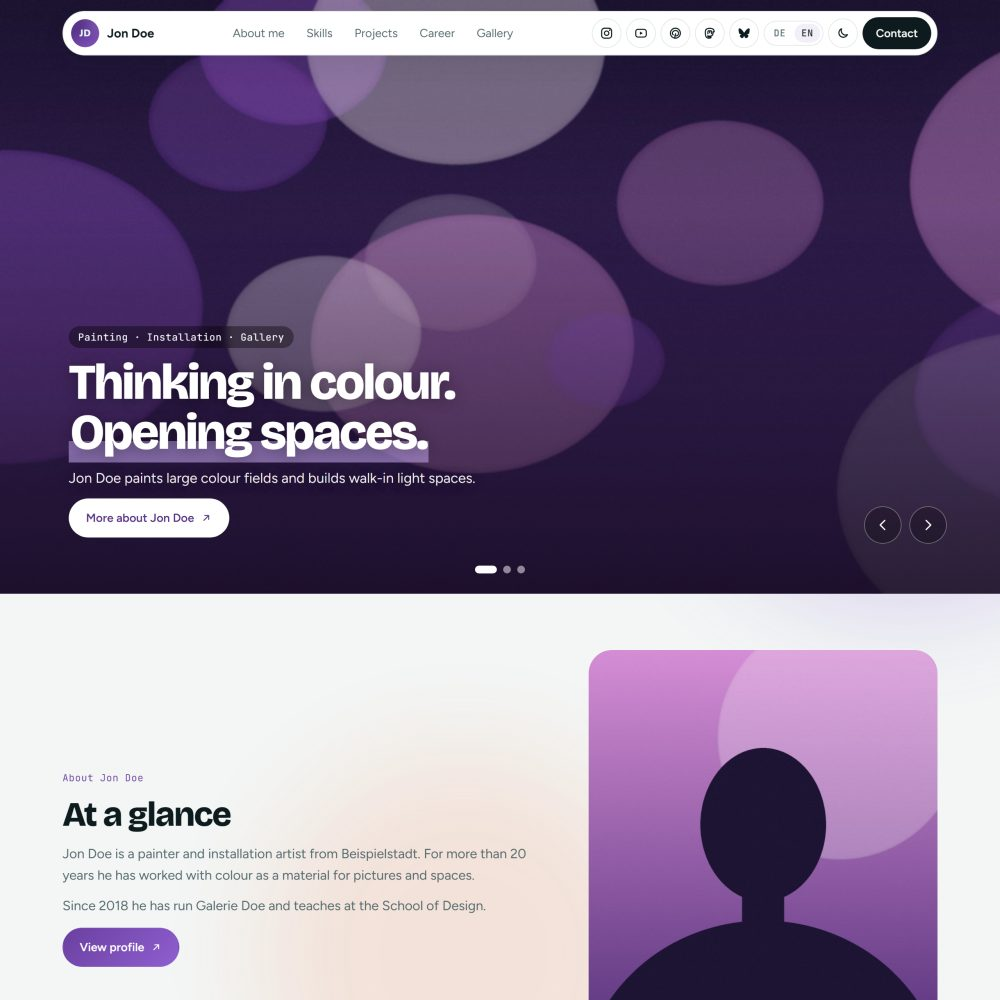

# AboutME – Grav theme for personal profile sites

AboutME is a modern one-page theme for [Grav CMS](https://getgrav.org) built for personal profile, CV and "about me" websites. It is bilingual out of the box (German and English), works with light and dark mode, and loads no external services: fonts, icons and scripts are all self-hosted.

## Features

- **Modular profile page** with header (photo, status line, buttons, info cards, key figures), sections ("about me" topics), skills, projects and a contact block
- **Further page types:** timeline ("Stationen"), page with intro, gallery and videos, contact form with thank-you page, articles and news with overview pages
- **Optional front page** in front of the profile: full-width image slider, short profile teaser, latest articles, news slider and contact, each section can be switched on or off
- **Appearance:** 12 colour schemes, 4 backgrounds (gradient, aurora, dot grid, plain), light/dark mode with optional toggle, 5 heading fonts and 5 body fonts
- **Menu:** built automatically or edited as a list in the admin (the list is the menu, prefilled with the current pages)
- **Social media:** 19 networks with icons, sortable, each one can be shown in the top menu or only in the contact block
- **Multilingual:** German and English included, further languages can be added via `languages.yaml`. Lists such as timeline, skills, projects, gallery or slider are kept in sync automatically: add an entry in the main language, and the other languages receive it ready for translation
- **Gallery:** landscape or portrait thumbnails (also per image), animated GIFs, lightbox in full resolution
- **Privacy by design:** self-hosted fonts, no tracking, videos linked instead of embedded, e-mail addresses obfuscated against harvesters
- **Bilingual admin:** all theme options and page fields are labelled in German and English (following the admin language)

## Requirements

- Grav 2.1 or newer (tested with Grav 2.2.4), PHP 8.3 or newer
- Recommended: Admin 2 (Admin Next) with the API plugin
- For the contact form: the Form and Email plugins

## Installation

1. Copy the folder `aboutme` to `user/themes/` of your Grav installation.
2. In `user/config/system.yaml` set `pages: theme: aboutme`, or choose the theme in the admin under *Themes*.
3. Clear the cache.

### Demo content (recommended)

The theme ships with a complete example site of the fictional artist **Jon Doe** in German and English (profile, timeline, gallery, articles, news, front page, contact form, legal pages). It is the quickest way to see every page type and to use it as a starting point.

- **With the Grav package manager:** when the theme is installed via `bin/gpm install`, Grav asks whether to install the demo content.
- **Manually:** copy the contents of `aboutme/_demo/` into your `user/` folder.

**Important:** the demo replaces `user/pages` and the files `user/config/site.yaml`, `user/config/system.yaml` and `user/config/themes/aboutme.yaml`. Back up your own pages and configuration first. The legal pages (imprint, privacy policy) only contain placeholders and must be replaced with your own texts.

## Configuration

All options are in the admin under *Themes → AboutME*:

| Section | Options |
|---|---|
| Name and logo | name in the menu bar, monogram (initials are used if empty; also used for the favicon) |
| Appearance | colour mode, colour scheme, background, heading font, body font, light/dark toggle |
| Language | automatic language selection based on the browser |
| Front page | switch the optional front page on or off, its route and each of its sections |
| Menu | menu entries with text, translations, target and "open in new tab" |
| Social media | profiles, order, "show in top menu" |
| Footer | footer text, imprint and privacy pages |

### Page types

| Page type | Use |
|---|---|
| Modular page | profile page built from modules: header, about me (topics), skills, projects, contact, free text, image slider, profile teaser, articles, news |
| Page with intro | text page with intro, link card, gallery and videos |
| Timeline | career and education as a timeline |
| Contact form | form with redirect to a thank-you page |
| Overview / Post | articles and news with overview pages |

### Multiple languages

Language files follow Grav's naming scheme (`page.de.md`, `page.en.md`). The default language is the main language: lists are maintained there. When a page is saved in the main language, the theme updates the other languages: new entries appear with the main-language text for translation, order and deletions are applied, shared fields such as images, links or categories are copied, and existing translations are kept. Each list entry carries a hidden `uid` for this.

## Fonts and licences

Bundled fonts (SIL Open Font License 1.1): Bricolage Grotesque, Fraunces, Playfair Display, Sora, Space Grotesk, Figtree, Inter, Roboto, Open Sans, Source Sans 3, JetBrains Mono.

The demo person Jon Doe and all demo content are fictional. Demo images are abstract graphics created for this theme and may be used together with it.

## License

MIT, see [LICENSE](LICENSE). © 2026 Andreas G. Neuhauser
